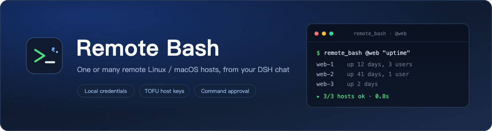
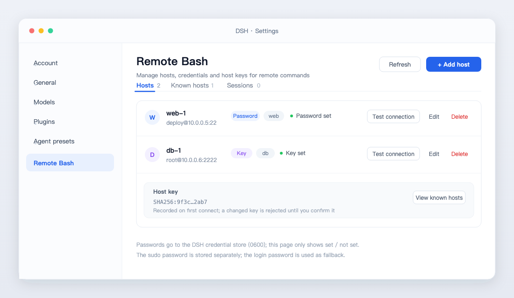
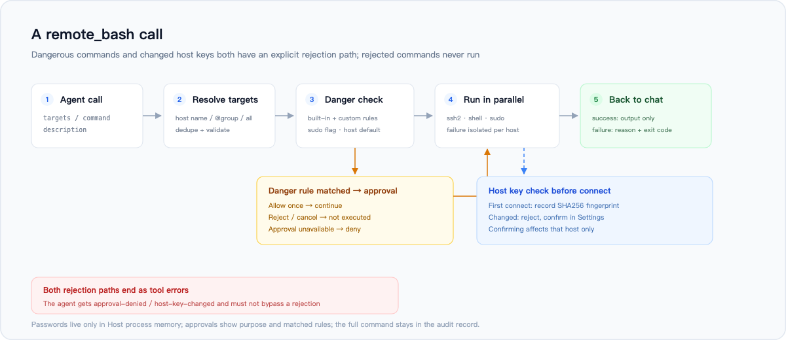
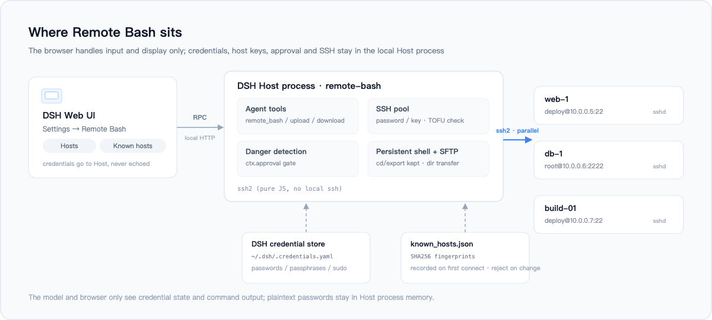

<p align="center">
  
</p>

<p align="center">
  <b>English</b> · <a href="README.zh.md">简体中文</a>
</p>

<p align="center">
  <a href="https://github.com/wybiacx/dsh-remote-bash/actions/workflows/ci.yml"></a>
  
  = 20">
</p>

Remote Bash is an SSH plugin for DeepSeek Harness (DSH). Register a few remote Linux / macOS hosts in Settings, then let the agent run commands on one host or a whole group in a single call.

Passwords, private keys and sudo passwords are stored in the local DSH credential store; the model only sees whether a credential is configured. Host keys are recorded on first connect and rejected if they change later. Dangerous commands go through an approval prompt, and a persistent session keeps `cd` / `export` state between calls.

## Settings page

The plugin adds a **Remote Bash** section to Settings, with three tabs: hosts, known hosts and persistent sessions. Each host row can test the connection, edit credentials and show its recorded fingerprint.



*Layout illustration; colors follow your DSH theme.*

## Installation

Requires DSH 0.2.x (tested on `0.2.1-rc.3`) and Node 20+. The plugin depends on `ssh2`, which npm installs during setup; no local `ssh` client or `sshpass` is needed.

Install from GitHub from inside DSH (it asks for approval once):

```js
plugin_manager({
  action: 'install_bundle',
  target: 'git+https://github.com/wybiacx/dsh-remote-bash.git'
})
```

For production use, pin a commit so upstream changes do not hit your environment directly:

```js
plugin_manager({
  action: 'install_bundle',
  target: 'git+https://github.com/wybiacx/dsh-remote-bash.git#<commit>'
})
```

For local development, point at the checkout:

```js
plugin_manager({ action: 'install_bundle', target: '/absolute/path/to/dsh-remote-bash' })
```

After the first install, refresh the browser once and the **Remote Bash** section appears in Settings. For `link:` installs, toggle the plugin row off and on again (or restart DSH) to load Host-side changes.

## Configuration

Configuration lives in the profile's `cordis.patch.yml`:

```yaml
- insert:
    - id: remote-bash
      name: 'dsh-remote-bash'
      config:
        dataDir: ''                  # default: <DSH_HOME>/remote-bash
        defaultTimeoutSec: 60        # per-host command timeout
        maxParallelHosts: 8          # concurrent hosts
        maxOutputBytes: 32768        # per-host output cap
        sessionIdleMinutes: 30       # idle timeout for persistent sessions
        approvalMode: dangerous      # dangerous | always | trusted
        extraDangerousPatterns: []   # additional danger regexes (strings)
```

`approvalMode` controls when approval is requested:

| Value | Behavior |
|---|---|
| `dangerous` (default) | Ask only when a danger rule matches (including `sudo`) |
| `always` | Ask for every remote command |
| `trusted` | Never ask, execute directly |

## Usage

```
> check disk usage on web-1

  remote_bash({ targets: 'web-1', command: 'df -h /', description: 'check root filesystem usage' })
```

Common patterns:

| Goal | Parameters |
|---|---|
| Run on every host in the `web` group | `targets: '@web'` |
| Pick specific hosts | `targets: 'web-1, db-1'` (name or id) |
| Start in a directory | `cwd: '/opt/app'` |
| Keep `cd` / `export` state | `session: 'deploy'`, reused by name across calls |
| Need root | `sudo: true` (uses the host's sudo password, falls back to the login password) |
| Transfer files | `remote_upload` / `remote_download`, with `{host}` and `{name}` templates |

There are five tools:

| Tool | Purpose |
|---|---|
| `remote_bash` | Run a command on one or many hosts; supports `cwd`, `timeoutSec`, `session`, `sudo` |
| `remote_hosts` | List hosts, groups and credential state (never passwords) |
| `remote_upload` | Upload files or directories over SFTP, recursive |
| `remote_download` | Download over SFTP; multi-host downloads use `<name>-<file>` or `<name>/` |
| `remote_sessions` | List or close persistent sessions |

`remote_bash` also takes a `description`: one line describing what the command is for. It shows up in the approval dialog and the tool card, which makes approvals easier to read; the full command stays in the audit record.

## Authentication and security

The full path of one call:



**Credentials.** Passwords, key passphrases and sudo passwords go into the `records` space of the DSH credential store (`remote-bash/refs/<UUID>`; legacy `remote-bash/<hostId>` records remain readable) with file mode 0600. Reads and writes happen only inside the Host process, and the API returns just "configured / not configured". One boundary is worth stating: like the DSH credential store itself, any process running as the same OS user (including the agent's shell tools) can read that file in principle. That is a file-permission limit; the plugin cannot isolate further.

**Host keys.** On first connect the SHA256 fingerprint of the host key is written to `known_hosts.json`, and every later connection is checked against it. A mismatch rejects the connection and leaves the new fingerprint pending in Settings; approving it affects that one host. This protects against man-in-the-middle and also catches a replaced machine.

**Dangerous commands.** Commands matching a built-in rule (`rm -rf` on dangerous paths, `mkfs`, `dd` to a device, shutdown, stopping critical services, account changes, firewall flushes, overwriting system config, etc.) or carrying `sudo` go through `ctx.approval`. The rules are regex heuristics: they can miss and they can false-positive, and a false positive costs one extra confirmation. Add `extraDangerousPatterns`, or use `approvalMode: always`. If the approval service is unavailable, the command is denied.

**sudo passwords** are sent through SSH stdin only after a per-command authentication prompt. Generated commands contain no password, and the target command has separate, empty stdin. Cached authentication and NOPASSWD send no password. Sudo runs a non-login Bash shell, so it does not automatically source login profiles.

**Commands and output** become part of the current session record; that is how DSH works, so keep secrets out of commands. The plugin does not collect data and does not talk to any network address other than the hosts you configure.

Report security issues privately as described in [SECURITY.en.md](SECURITY.en.md).

## Architecture



The Host process opens SSH connections itself, using the pure-JS `ssh2` package. That avoids depending on the local ssh version and needs no askpass helper for password auth; SSH agent forwarding is not implemented. The browser half only handles the Settings page and talks to the Host over a DSH-authenticated local RPC (`/api/remote-bash/rpc`).

Persistent sessions are `bash -s` on the same SSH channel, without a PTY. `cd` and `export` survive between calls; terminal programs such as vim or top do not work. Commands have empty stdin by default; use explicit pipes or redirection when input is needed. Cancelling or timing out an active session command closes that session; a later call can create a new one. Busy sessions are not evicted as idle. Cancelling a queued call does not cancel another active call.

## Repository layout

```
host/          Host side: tools, RPC, SSH, credentials, approval, persistent sessions
client.js      Browser Settings page (settings.section)
tests/         End-to-end tests and the mock SSH server
docs/images/   README artwork (SVG sources + PNG exports)
INTERFACE.md   Host/Client interface contract
```

## Execution and recovery

Approval uses a fixed target snapshot. New group members are not silently added while approval is pending; changing a selected host returns `target-changed` before further execution on that host. Explicit `sudo: false` overrides the host default. Do not automatically retry commands that may already have changed remote state. Cancellation closes client channels and stops further dispatch; it cannot guarantee termination of detached remote processes or roll back side effects.

Downloads reject path traversal and destination symlinks. Files are downloaded to private temporary storage beside the destination and replaced only on success; existing file contents survive failed transfers. Remote directory symlinks are not followed.

Inventory v1 upgrades to v2 on the first write, retaining existing host IDs and credentials. A non-secret `inventory.json.v1.bak` is created before migration. New hosts receive unique IDs; selecting hosts by name continues to work. Save stages a new credential record before atomically switching its inventory reference. Interrupted or failed cleanup remains visible in Settings and can be retried without deleting an active host. Only journaled retired credentials are cleaned up.

Do not run multiple Host instances against the same data directory. Older plugin versions must not write the v2 inventory; the inventory backup alone is not a full rollback backup because it contains no credentials. No migration is performed merely by updating this checkout; it happens when the updated plugin writes its configured data.

## Data files

Default location is `<DSH_HOME>/remote-bash` (`~/.dsh/remote-bash` when `DSH_HOME` is unset; override with `dataDir`):

| File | Content | Mode |
|---|---|---|
| `inventory.json` | Host list, no passwords | 0600 |
| `known_hosts.json` | TOFU fingerprints | 0600 |
| `~/.dsh/.credentials.yaml` | Passwords / passphrases, managed by the DSH credential store | 0600 |

## Tests

```bash
npm install
npm test            # all unit, integration, regression and client tests
npm run test:mock   # self-test for the mock SSH server (optional)
```

The tests start a real SSH server on `127.0.0.1` with `ssh2` and cover authentication, TOFU and host-key rotation, single- and multi-host execution, failure isolation, timeouts, persistent sessions, correct/incorrect sudo passwords, SFTP files and directories, dangerous-command detection, credential handling and the RPC envelope. CI runs the suite on Node 20 (current maintenance release), 22 and 24. A separate isolated container exercises real OpenSSH and sudo (password, rejected password, cached and NOPASSWD authentication). That test is explicitly skipped during ordinary local runs without its CI fixture. Browser component tests exercise the actual client module but do not replace visual verification.

## Known limitations

- Targets must be Linux / macOS (POSIX shell).
- Persistent sessions have no PTY, so interactive TUI programs do not work.
- Dangerous-command rules are heuristics: they accept false positives and may miss things.
- Local paths are resolved relative to the Host process working directory; absolute paths are safer.
- The Settings section appears after a page refresh following the first install.
- Not supported yet: SSH agent, bastion hosts / ProxyJump, Windows targets.

## Development

- `INTERFACE.md` is the Host/Client contract (RPC methods, service methods, result shapes, tool parameters). Read it before changing code.
- Host changes load after toggling the plugin row off and on; `client.js` changes apply on page refresh.
- Tests use `node --test` and need no real remote host; add new cases under `tests/`.

## License

[MIT](LICENSE) © 2026 wybiacx
