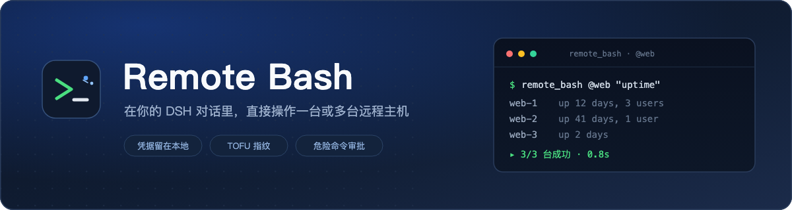
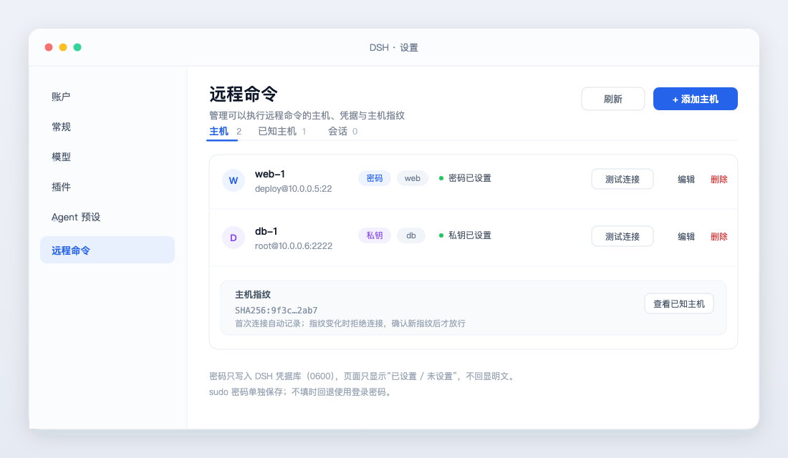
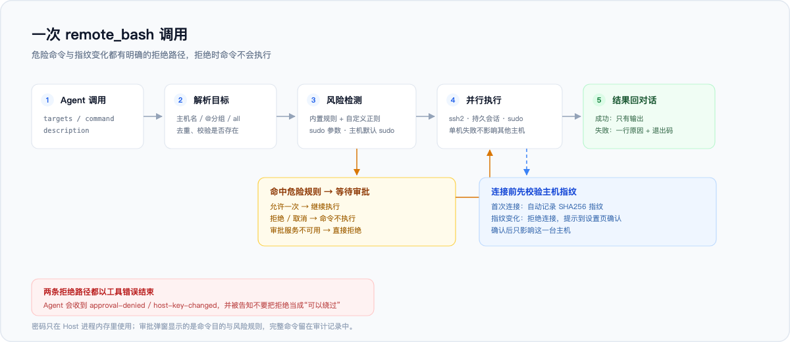
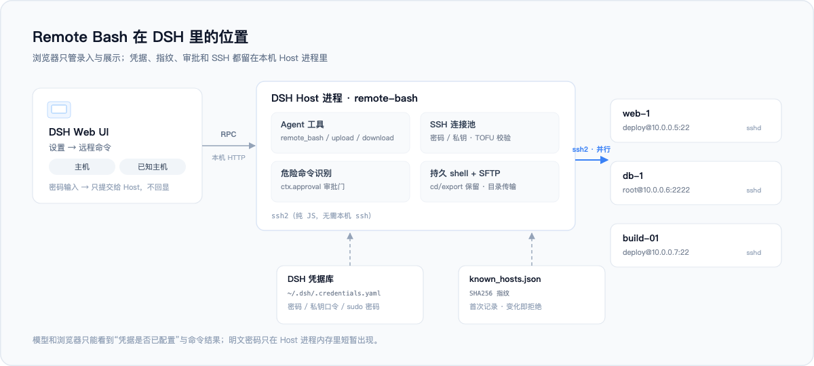

<p align="center">
  
</p>

<p align="center">
  <a href="README.md">English</a> · <b>简体中文</b>
</p>

<p align="center">
  <a href="https://github.com/wybiacx/dsh-remote-bash/actions/workflows/ci.yml"></a>
  
  = 20">
</p>

Remote Bash 是一个给 DeepSeek Harness（DSH）用的 SSH 插件。在设置页登记远程 Linux / macOS 主机之后，对话里就能让 Agent 单台执行命令，或者按分组一次跑多台。

账号密码、私钥和 sudo 密码存在本机凭据库，模型只能看到凭据有没有配；主机指纹首次连接自动记录，之后变化就拒绝；危险命令执行前会弹审批；需要保留 `cd`、`export` 状态时可以开持久会话。

## 界面

设置页在「设置 → 远程命令」，分成主机、已知主机、持久会话三块。主机行里可以直接测试连接、改密码、看指纹状态。



*示意图，实际配色跟随你的 DSH 主题。*

## 安装

要求 DSH 0.2.x（在 `0.2.1-rc.3` 上验证过），Node 20 以上。插件依赖 `ssh2`，安装时会从 npm 自动拉取，不需要本机的 `ssh` 客户端或 `sshpass`。

从 GitHub 安装，在 DSH 里调用（会请求一次权限审批）：

```js
plugin_manager({
  action: 'install_bundle',
  target: 'git+https://github.com/wybiacx/dsh-remote-bash.git'
})
```

正式使用建议钉住 commit，避免上游改动直接影响你的环境：

```js
plugin_manager({
  action: 'install_bundle',
  target: 'git+https://github.com/wybiacx/dsh-remote-bash.git#<commit>'
})
```

本地开发时直接指向仓库目录：

```js
plugin_manager({ action: 'install_bundle', target: '/absolute/path/to/dsh-remote-bash' })
```

首次安装后刷新一次浏览器页面，设置里就会出现「远程命令」。本地 `link:` 安装的包，改完 Host 代码要把插件行关掉再打开（或者重启 DSH）才会加载新模块。

## 配置

配置写在 profile 的 `cordis.patch.yml` 里：

```yaml
- insert:
    - id: remote-bash
      name: 'dsh-remote-bash'
      config:
        dataDir: ''                  # 默认 <DSH_HOME>/remote-bash
        defaultTimeoutSec: 60        # 单机命令默认超时
        maxParallelHosts: 8          # 多主机并发上限
        maxOutputBytes: 32768        # 单机输出上限
        sessionIdleMinutes: 30       # 持久会话空闲回收
        approvalMode: dangerous      # dangerous | always | trusted
        extraDangerousPatterns: []   # 追加危险命令正则（字符串数组）
```

`approvalMode` 决定什么时候弹审批：

| 值 | 行为 |
|---|---|
| `dangerous`（默认） | 只有命中危险规则（含 `sudo`）时才问 |
| `always` | 每条远程命令都问 |
| `trusted` | 不问，直接执行 |

## 在对话里用

```
> 看一下 web-1 的磁盘占用

  remote_bash({ targets: 'web-1', command: 'df -h /', description: '查看根分区磁盘占用' })
```

几个常见用法：

| 想做什么 | 参数 |
|---|---|
| 所有 web 分组机器执行同一条命令 | `targets: '@web'` |
| 指定几台机器 | `targets: 'web-1, db-1'`（主机名或 id 都行） |
| 进某个目录再跑 | `cwd: '/opt/app'` |
| 保持 `cd` / `export` 状态 | `session: 'deploy'`，同一个名字跨调用复用 |
| 需要 root | `sudo: true`（用该主机保存的 sudo 密码，没配则回退登录密码） |
| 传文件 | `remote_upload` / `remote_download`，支持 `{host}`、`{name}` 模板 |

工具一共五个：

| 工具 | 作用 |
|---|---|
| `remote_bash` | 单台或多台主机执行命令，支持 `cwd`、`timeoutSec`、`session`、`sudo` |
| `remote_hosts` | 列主机、分组和凭据状态（不含密码） |
| `remote_upload` | SFTP 上传文件或目录，支持递归 |
| `remote_download` | SFTP 下载；多主机时自动按 `<name>-<文件名>` 或 `<name>/` 区分 |
| `remote_sessions` | 列出或关闭持久会话 |

`remote_bash` 还要求填一个 `description`，用一句话说明这条命令想做什么。它会出现在审批弹窗和会话卡片里，审批时“查看磁盘占用”比一长串 shell 好读，完整命令只留在审计记录里。

## 认证与安全

一次调用的完整路径：



**凭据。** 密码、私钥口令、sudo 密码写进 DSH 凭据库的 records 空间（新记录为 `remote-bash/refs/<UUID>`，继续兼容旧 `remote-bash/<hostId>`），文件权限 0600；读写只在 Host 进程里发生，接口只返回“已设置 / 未设置”。这里有一条必须说明的边界：和 DSH 凭据库本身一样，同一 OS 用户下的进程（包括 Agent 的 shell 工具）理论上可以读到那个文件。这属于文件权限层面的限制，插件无法进一步隔离。

**主机指纹。** 首次连接时把主机公钥的 SHA256 指纹记到 `known_hosts.json`，之后每次连接都核对；不一致就拒绝连接，并在设置页留下待确认的新指纹。确认新指纹只影响这一台主机。这一步主要防中间人，也顺手挡住“机器被换掉”的情况。

**危险命令审批。** 命中内置规则（`rm -rf` 危险路径、`mkfs`、`dd` 写设备、关机、停关键服务、改账户、清防火墙、写系统配置等）或者带 sudo 时，会走 `ctx.approval`。规则是正则启发式，会漏报也会误报，误报的代价是多点一次确认；漏报可以用 `extraDangerousPatterns` 补，或者直接 `approvalMode: always`。审批服务不可用时按拒绝处理。

**sudo 密码。** 只有收到本次命令的认证提示后，才通过 SSH stdin 发送密码；生成的命令文本不含密码，业务命令的 stdin 单独置空。缓存认证和 NOPASSWD 不发送密码。sudo 使用非登录 Bash，不自动加载登录 profile。

**命令和输出**都会进入当前会话记录，这是 DSH 的工作方式，别把密码写进命令。插件本身不收集数据，也不访问除你配置的主机之外的网络地址。

安全问题请按 [SECURITY.md](SECURITY.md) 的方式私下报告。

## 架构



SSH 由 Host 进程直接发起，用的是纯 JS 的 `ssh2`，不依赖本机 ssh 版本，密码认证也不需要 askpass 脚本；目前没有做 SSH agent 转发。浏览器那半边只负责设置页的增删改查，通过一条带 DSH 鉴权的本机 RPC（`/api/remote-bash/rpc`）跟 Host 通信。

持久会话是同一个 SSH channel 上的 `bash -s`，没有 PTY。所以 `cd`、`export` 能保留，vim、top 这类需要终端的程序跑不了；命令默认 stdin 为空，需要输入时显式使用管道或重定向。取消或超时会关闭正在执行该命令的会话，下次调用可重新建立；忙碌会话不会被空闲回收。取消排队调用不取消另一个正在执行的调用。

## 仓库结构

```
host/          Host 侧：工具、RPC、SSH 连接、凭据、审批、持久会话
client.js      浏览器设置页（settings.section）
tests/         端到端测试与 mock SSH 服务器
docs/images/   README 配图（SVG 源文件 + PNG）
INTERFACE.md   Host 与 Client 的接口约定
```

## 执行与失败恢复

审批使用固定目标快照。等待审批期间加入分组的新主机不会自动加入本次执行；已选主机发生变化时，对该主机返回 `target-changed`。显式 `sudo: false` 覆盖主机默认提权。不要自动重试可能已经产生副作用的命令。取消会关闭客户端通道并停止后续派发，但不能保证终止已脱离 SSH 的进程，也不能撤销已发生的操作。

下载拒绝路径穿越和目标符号链接，文件先下载到目标旁的私有临时目录，成功后再替换；失败不会破坏原文件内容。远端目录符号链接不递归跟随。

旧清单在首次写入时升级为 v2，保留已有主机 ID 和凭据，升级前生成不含秘密的 `inventory.json.v1.bak`。新主机使用唯一 ID，仍可按名称选择。保存先写新凭据，再原子切换清单引用；中断或失败的清理在设置页显示，可单独重试，不会删除活动主机。只清理恢复日志中已退役的凭据。

不要让多个 Host 实例同时使用同一数据目录。旧插件不能继续写入 v2 清单；清单备份不含凭据，不能单独作为完整回滚备份。仅更新源码不会迁移实际配置，更新后的插件写入其数据目录时才会升级。

## 数据文件

默认在 `<DSH_HOME>/remote-bash`（没有 `DSH_HOME` 时是 `~/.dsh/remote-bash`，可用 `dataDir` 覆盖）：

| 文件 | 内容 | 权限 |
|---|---|---|
| `inventory.json` | 主机清单，不含密码 | 0600 |
| `known_hosts.json` | TOFU 指纹 | 0600 |
| `~/.dsh/.credentials.yaml` | 密码 / 口令，由 DSH 凭据库统一管理 | 0600 |

## 测试

```bash
npm install
npm test        # 全部单元、集成、回归和客户端交互测试
npm run test:mock   # mock SSH 服务器自己的冒烟测试（可选）
```

测试用 `ssh2` 在 `127.0.0.1` 起了一个真的 SSH 服务器，覆盖认证、TOFU 与指纹轮换、单机与多机执行、失败隔离、超时、持久会话、sudo 正确/错误密码、SFTP 文件与目录、危险命令识别、凭据读写和 RPC 信封。CI 在 Node 20 当前维护版本、22 与 24 上运行；独立隔离容器验证真实 OpenSSH 和 sudo 的密码、错误密码、缓存认证、NOPASSWD 路径。普通本地测试没有专用 CI 环境时明确跳过真实 OpenSSH 用例。客户端测试运行实际组件逻辑，不能替代浏览器视觉验证。

## 已知限制

- 目标主机只支持 Linux / macOS（POSIX shell）。
- 持久会话没有 PTY，交互式 TUI 程序跑不了。
- 危险命令规则是启发式，接受误报，也可能漏报。
- 本地路径按 Host 进程的工作目录解析相对路径，建议直接传绝对路径。
- 首次安装后需要刷新页面，设置里才会出现「远程命令」。
- 暂不支持：SSH agent、跳板机 / ProxyJump、Windows 目标。

## 开发

- `INTERFACE.md` 是 Host 与 Client 的接口约定（RPC 方法、service 方法、返回结构、工具参数），改代码前先看。
- 改完 Host 代码，在 DSH 里把插件行关掉再打开即可重载；`client.js` 的改动刷新页面生效。
- 测试用 `node --test`，不需要真实远程主机；新增场景往 `tests/` 里加即可。

## License

[MIT](LICENSE) © 2026 wybiacx
